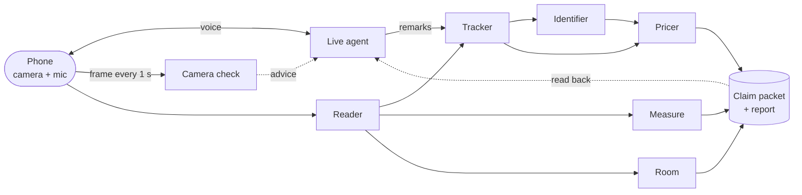

# Library claim agent

A phone agent that films a home library, talks the policyholder through the sweep, and writes a contents claim packet: every book and item, priced, with a review queue and totals.

## Walkthrough

[](https://drruin.github.io/library-claim-agent/)

The [sample claim report](https://drruin.github.io/library-claim-agent/report/report.html) opens in the browser.

## Install and run

Needs [uv](https://docs.astral.sh/uv/) and a Gemini API key.

```bash
uv sync
cp .env.example .env        # set GEMINI_API_KEY
uv run pytest               # 52 tests, no model calls
uv run uvicorn app.main:app --port 8300
```

Open `http://127.0.0.1:8300`. A phone needs HTTPS for the camera: `cloudflared tunnel --url http://127.0.0.1:8300`.

Without a phone, replay a photo and score it:

```bash
uv run python -m app.replay submission/ground_truth/photo.jpg --frames 12 --overlap 0.75
uv run python -m app.evaluate --packet runs/<id>/claim_packet.json --truth submission/ground_truth --out results/<id>/
```

`BUDGET_USD` (default 5) stops a process before it spends more. Other settings are listed in `.env.example`.

## Flow



## Agents

| Agent | Model | Job |
|---|---|---|
| Live agent | gemini-3.8-live | Talks the policyholder through the sweep, hears remarks, reads the packet back |
| Camera check | gemini-3.8-flash | Flags blur, glare or distance on each frame |
| Reader | gemini-4-argon | Reads every spine and every other object in a frame |
| Tracker | gemini-4-argon | Counts each book once across frames, in shelf order |
| Identifier | gemini-4-argon + Search | Finds the work, and Flash confirms it on the source page |
| Pricer | gemini-4-argon + Search | New and used price in the local market, and Flash rereads each price |
| Measure | code | Spine and item sizes from an A4 sheet in view |
| Room | gemini-4-argon + code | Model points at corners and doors, and code computes floor and wall area |
| Packet | code | Totals, review queue, report |

Models make every judgement through a Pydantic schema. Code does the arithmetic.

## Results

Shelf photo replay, 63 books (`submission/`):

| Bar | Target | Result |
|---|---|---|
| Book count | within 5% | 63 of 63 |
| Titles identified | 70% or more | 95.8% |
| Confidently wrong | 3% or less | 0 of 56 |
| Packet time | 5 min | first packet under 5 min, final at 707 s |

## Repo

| Folder | What is in it |
|---|---|
| [`app/`](app/) | Server and agents |
| [`web/`](web/) | Phone page |
| [`tests/`](tests/) | Tests |
| [`docs/`](docs/) | Architecture note and failure log |
| [`submission/`](submission/) | Packet, report, video, ground truth |
