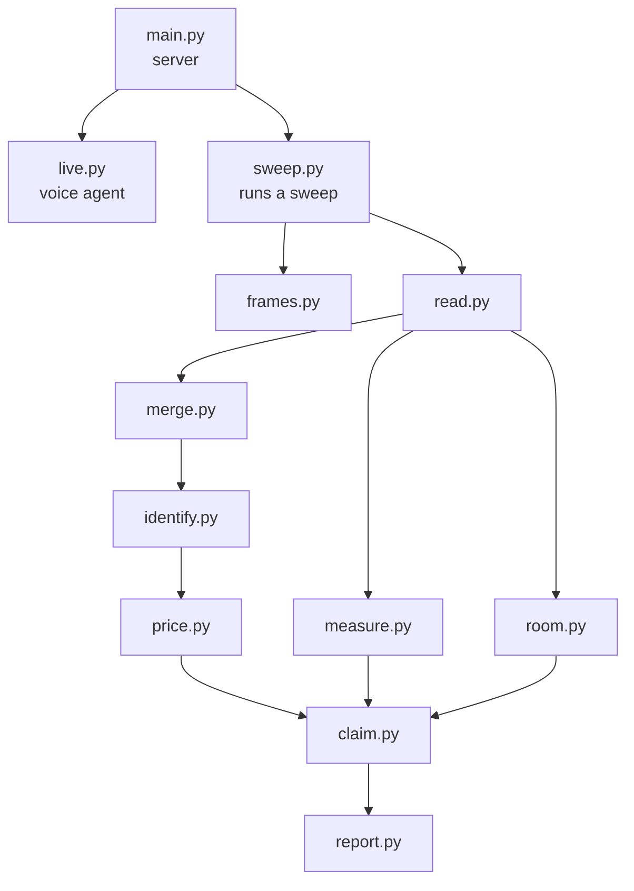

# app

| File | Job |
|---|---|
| `main.py` | Serves the phone page and the `/ws/sweep` socket |
| `live.py` | Gemini Live voice agent and its tools |
| `sweep.py` | Saves frames and starts each stage |
| `frames.py` | Camera check per frame |
| `read.py` | Reads spines and objects |
| `merge.py` | Tracks books across frames |
| `identify.py` | Finds each book with Google Search |
| `price.py` | Prices books and items |
| `measure.py` | Sizes from the A4 sheet |
| `room.py`, `geometry.py` | Room area |
| `claim.py`, `packet.py` | Builds the packet and its schema |
| `report.py`, `report.html` | The report page |
| `llm.py` | Gemini client with the spend limit |
| `config.py` | Settings |
| `replay.py` | Runs a photo through the pipeline |
| `evaluate.py`, `judge.py` | Scores a packet against ground truth |
